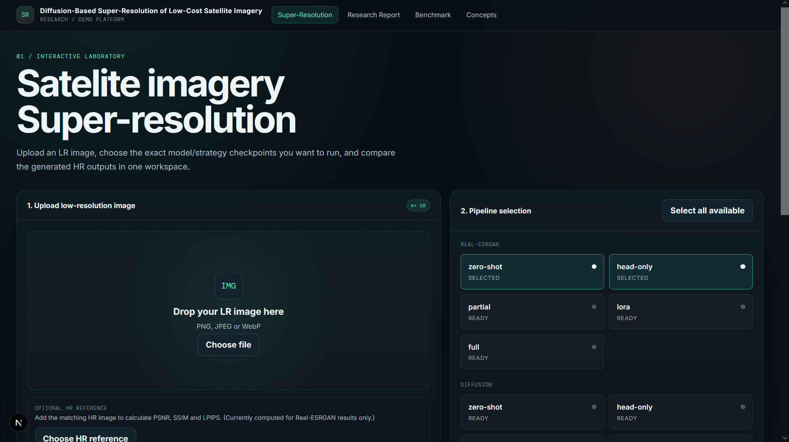
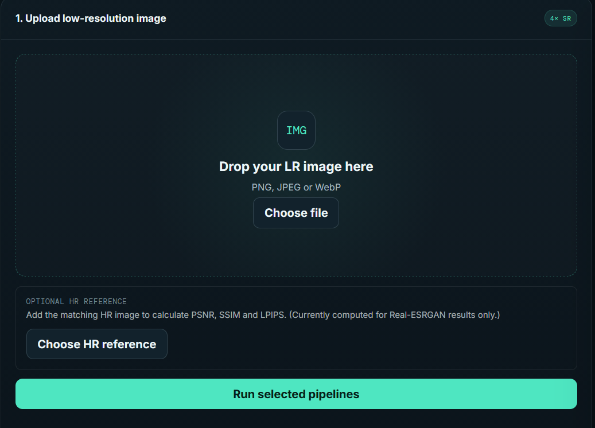
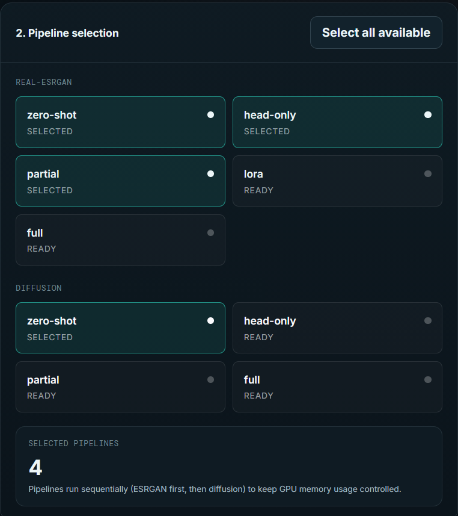
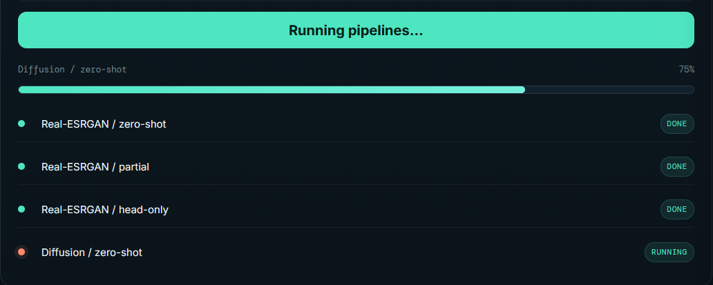
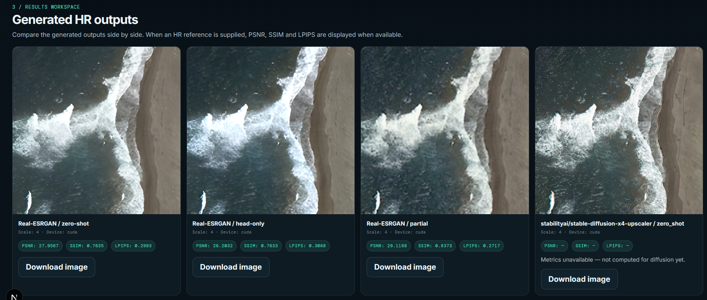
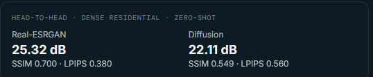
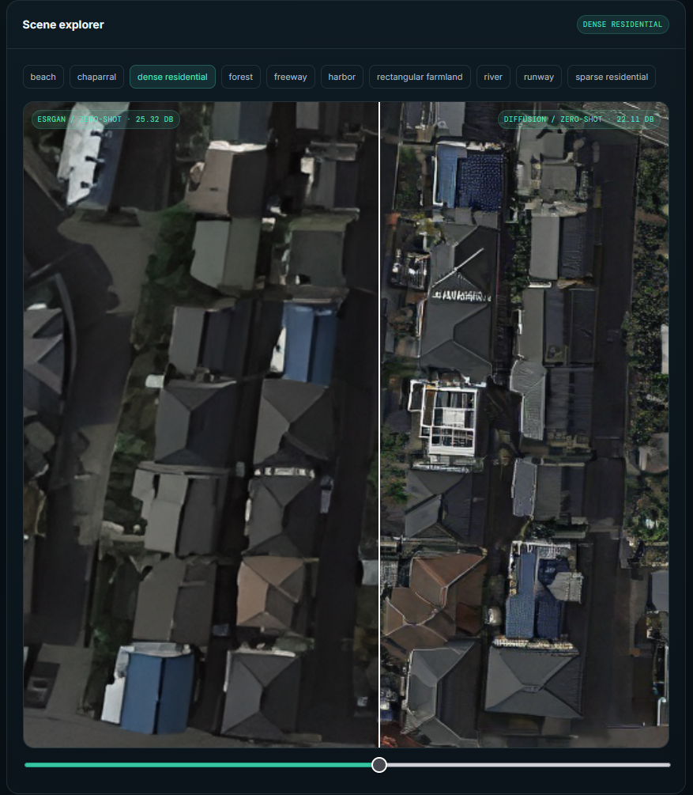

# Satellite Super-Resolution Platform

An interactive web platform for exploring **4x super-resolution of satellite and aerial imagery**,
comparing a GAN-based model (**Real-ESRGAN**) against a diffusion-based model
(**Stable Diffusion x4 Upscaler**) in both zero-shot form and several fine-tuned variants.

Upload an image, pick a model and fine-tuning strategy, and see the upscaled result next to
the original with quantitative metrics. A separate benchmark section presents the full
research results scene by scene.

> **Research repository:** methodology, training code, benchmark numbers and the full report
> live in [link to research repo]. This repository is the deployed application built on top of them.

<!-- Optional: add a live demo link and badges here -->
<!-- **Live demo:** https://your-demo-url -->



<!-- SCREENSHOT: full-width hero shot of the platform (Lab page with a finished result) -->

---

## Table of contents

1. [What it does](#what-it-does)
2. [Screenshots](#screenshots)
3. [Why two models](#why-two-models)
4. [Models and strategies available](#models-and-strategies-available)
5. [Architecture](#architecture)
6. [Project structure](#project-structure)
7. [Getting started](#getting-started)
8. [Configuration](#configuration)
9. [Checkpoints](#checkpoints)
10. [API reference](#api-reference)
11. [Limitations and honest caveats](#limitations-and-honest-caveats)
12. [Relationship to the research repo](#relationship-to-the-research-repo)
13. [Roadmap](#roadmap)
14. [References](#references)
15. [License](#license)

---

## What it does

- **Lab**: upload a low-resolution image, choose a model and a fine-tuning strategy, and run
  4x super-resolution. The result is shown beside the input so differences are easy to inspect.
- **Metrics**: quality metrics are computed for each run (PSNR, SSIM, LPIPS) when a
  ground-truth reference is available.
- **Benchmark**: a browsable gallery of the research results, with per-scene comparisons
  of every model/strategy pair and the summary tables from the study.
- **Honest framing**: diffusion output is presented as a _generative candidate_, not as ground
  truth, because it can invent plausible but incorrect detail. See
  [Why two models](#why-two-models).

---

## Screenshots

Replace each placeholder image with a real screenshot. Suggested file names are listed so
the paths in this README keep working.

### Lab

|                                                                        |                                                                                            |
| ---------------------------------------------------------------------- | ------------------------------------------------------------------------------------------ |
|                      |            |
| **Upload** — drag-and-drop or file picker for the low-resolution input | **Model and strategy selection** — Real-ESRGAN or Diffusion, with the fine-tuning strategy |

|                                                                        |                                                                |
| ---------------------------------------------------------------------- | -------------------------------------------------------------- |
|        |         |
| **Processing state** — loading/progress indicator while the model runs | **Result view** — input and super-resolved output side by side |

|                                                                    |                                                            |
| ------------------------------------------------------------------ | ---------------------------------------------------------- |
|  |  |
| **Zoom / compare** — inspecting fine detail at pixel level         | **Metrics panel** — PSNR, SSIM, LPIPS for the run          |


<!-- SCREENSHOT: the labeled/gated warning shown when the user selects the diffusion model -->

**Diffusion warning / gate** — diffusion output is labeled as a generative candidate.

### Benchmark

|                                                                              |                                                                                          |
| ---------------------------------------------------------------------------- | ---------------------------------------------------------------------------------------- |
|  |  |
| **Summary table** — PSNR/SSIM per model and strategy                         | **Strategy comparison** — the same scene across every strategy                           |

|                                                                                  |                                                                                               |
| -------------------------------------------------------------------------------- | --------------------------------------------------------------------------------------------- |
|  |  |
| **Per-scene gallery** — the 10 held-out scenes                                   | **Hallucination close-up** — zoomed crop of invented detail                                   |

### Layout and responsiveness

|                                                               |                                                             |
| ------------------------------------------------------------- | ----------------------------------------------------------- |
|  |               |
| **Navigation shell** — shared header/sidebar across pages     | **Mobile view** — responsive layout on a phone-sized screen |

<!-- Optional extras worth capturing: dark mode, error state (backend offline), empty state, a short GIF of a full upload-to-result run -->

---

## Why two models

This platform exists to make a specific trade-off visible: the **perception-distortion
tradeoff** (Blau & Michaeli, 2018).

- **Real-ESRGAN** (GAN) tends to produce smoother, safer output. When it is unsure about fine
  detail, it converges toward an averaged answer. Its typical failure is mild under-texturing.
- **Stable Diffusion x4 Upscaler** (diffusion) samples stochastically and commits to sharp,
  specific-looking detail. That detail is only a statistically _plausible_ guess and can be
  wrong: an invented texture, or an object with no counterpart in the real scene.

For satellite imagery analysis, invented detail is a consequential error, not a cosmetic one.
For that reason Real-ESRGAN is the default in the interface, and diffusion output is shown as a
labeled secondary view.

---

## Models and strategies available

Base models:

| Model                        | Source                                                                                                      | Type                            |
| ---------------------------- | ----------------------------------------------------------------------------------------------------------- | ------------------------------- |
| Real-ESRGAN (x4)             | [xinntao/Real-ESRGAN](https://github.com/xinntao/Real-ESRGAN)                                               | GAN                             |
| Stable Diffusion x4 Upscaler | [stabilityai/stable-diffusion-x4-upscaler](https://huggingface.co/stabilityai/stable-diffusion-x4-upscaler) | Latent diffusion (v-prediction) |

Fine-tuning strategies exposed in the interface:

| Model       | zero-shot | head-only | LoRA         | partial | full              |
| ----------- | --------- | --------- | ------------ | ------- | ----------------- |
| Real-ESRGAN | yes       | yes       | yes          | yes     | yes               |
| Diffusion   | yes       | yes       | not deployed | yes     | yes (see caveats) |

<!-- TODO: edit this table to match exactly what model_registry.py exposes. -->

Fine-tuning was done on a small, synthetically degraded NAIP aerial-imagery set. Full numbers,
training details and the evaluation protocol are in the research repo.

---

## Architecture

```
Browser
   |
   |  Next.js frontend (frontend/)
   |    - Lab page        upload, model/strategy choice, results
   |    - Benchmark page  research results gallery and tables
   |
   |  HTTP (JSON + image upload)     NEXT_PUBLIC_API_URL
   v
FastAPI backend (backend/)
   |
   |-- main.py            routes, request validation
   |-- model_registry.py  maps (model, strategy) -> checkpoint, loads and caches models
   |-- esrgan_model.py    Real-ESRGAN inference
   |-- diffusion.py       Stable Diffusion x4 Upscaler inference
   |-- metrics.py         PSNR, SSIM, LPIPS
   |
   v
checkpoints/              fine-tuned weights (not in git)
```

Models are loaded on demand and cached by the registry, so the first request for a given
model/strategy is slower than later ones.

---

## Project structure

```
satellite-sr-platform/
├── frontend/
│   ├── app/
│   │   ├── lab/page.tsx            # Lab: upload, run, results
│   │   ├── benchmark/page.tsx      # Benchmark: research results
│   │   └── components/Shell.tsx    # shared layout / navigation
│   ├── public/
│   │   └── benchmark/              # per-scene benchmark images
│   ├── package.json
│   ├── next.config.js
│   └── .env.local.example          # NEXT_PUBLIC_API_URL=http://127.0.0.1:8000
├── backend/
│   ├── main.py
│   ├── diffusion.py
│   ├── esrgan_model.py
│   ├── model_registry.py
│   ├── metrics.py
│   ├── requirements.txt
│   ├── checkpoints/                # gitignored, see "Checkpoints"
│   └── .env.example
├── docs/
│   └── screenshots/                # images used by this README
├── .gitignore
└── README.md
```

---

## Getting started

### Prerequisites

- Python 3.10 or newer
- Node.js 18 or newer
- A CUDA-capable GPU is strongly recommended. The diffusion model runs about 30 denoising
  steps per image and is very slow on CPU. Real-ESRGAN is usable on CPU but slower.

### 1. Clone

```
git clone <this-repo-url>
cd satellite-sr-platform
```

### 2. Backend

```
cd backend
python -m venv venv
source venv/bin/activate        # Windows: venv\Scripts\activate
pip install -r requirements.txt
cp .env.example .env            # Windows: copy .env.example .env
```

Add the model checkpoints (see [Checkpoints](#checkpoints)), then start the server:

```
uvicorn main:app --reload --port 8000
```

<!-- TODO: confirm this matches how you actually start the backend. -->

The API is now at `http://127.0.0.1:8000`.

### 3. Frontend

In a second terminal:

```
cd frontend
npm install
cp .env.local.example .env.local   # Windows: copy .env.local.example .env.local
npm run dev
```

Open `http://localhost:3000`.

---

## Configuration

| Variable                       | Where                 | Purpose                 | Default                 |
| ------------------------------ | --------------------- | ----------------------- | ----------------------- |
| `NEXT_PUBLIC_API_URL`          | `frontend/.env.local` | Base URL of the backend | `http://127.0.0.1:8000` |
| _(see `backend/.env.example`)_ | `backend/.env`        | Backend settings        | —                       |

<!-- TODO: list each variable in backend/.env.example (for example checkpoint path, device, allowed origins). -->

---

## Checkpoints

Fine-tuned weights are **not** stored in this repository. They are binary, large and
regenerable, so `backend/checkpoints/` is gitignored.

Expected layout:

```
backend/checkpoints/
├── diffusion/
│   ├── head_only/
│   ├── partial/
│   └── full/
└── esrgan/
    └── ...                      # TODO: match the real folder names
```

<!-- TODO: confirm the exact folder names and whether each folder holds a run_id subfolder. -->

To obtain them, either:

1. **Train them yourself** with the scripts in the research repo
   (`python run_finetune.py --model diffusion --strategy partial`, and so on), then copy the
   outputs into `backend/checkpoints/`, or
2. **Download** them from <!-- TODO: add link (GitHub Release, Hugging Face Hub, or similar) -->.

If a checkpoint is missing, the corresponding model/strategy option will not work. The base
models themselves are downloaded automatically from their original sources on first use.

---

## API reference

<!-- TODO: replace with the real routes from main.py. The table below is a template. -->

| Method | Route      | Description                                                   |
| ------ | ---------- | ------------------------------------------------------------- |
| `GET`  | `/health`  | Backend status                                                |
| `GET`  | `/models`  | Available models and strategies                               |
| `POST` | `/upscale` | Upload an image, choose model and strategy, get the 4x result |
| `POST` | `/metrics` | Compute PSNR/SSIM/LPIPS against a reference                   |

Interactive documentation is available at `http://127.0.0.1:8000/docs` while the backend is running.

---

## Limitations and honest caveats

- **No real satellite validation yet.** The fine-tuning pairs are _synthetically degraded NAIP
  aerial imagery_, not real Sentinel-2 low-resolution imagery paired with independent
  high-resolution imagery. Performance on real Sentinel-2 data is suggested by these results,
  not proven by them.
- **Diffusion can hallucinate.** Output may contain realistic-looking detail that does not
  exist in the real scene. PSNR, SSIM and LPIPS cannot certify object-level correctness. Do not
  use diffusion output as a source of truth.
- **Diffusion + full checkpoint is unverified.** Its saved file size is far smaller than a
  genuine full UNet fine-tune should be, and the loader tolerates missing weights, so this
  option may behave like a smaller adaptation. Treat its results with caution until the
  research repo confirms otherwise.
- **Diffusion + LoRA is not deployed.** It produced no valid outputs in the first training pass.
- **Real-ESRGAN + head-only is worse than zero-shot** on the benchmark. It is included for
  completeness, not as a recommendation.
- **Hardware.** Diffusion inference is slow without a GPU.

---

## Relationship to the research repo

|          | Research repo                                    | This repo                                   |
| -------- | ------------------------------------------------ | ------------------------------------------- |
| Purpose  | Methodology, training, benchmark, report         | Deployed interactive application            |
| Changes  | Mostly frozen record of the study                | Evolves as the app is deployed and improved |
| Contains | Fine-tuning and evaluation scripts, results CSVs | Frontend, backend, serving code             |

Methodology and benchmark numbers: [link to research repo]

---

## Roadmap

<!-- Edit freely. These are suggestions based on the known limitations. -->

- [ ] Validate on real Sentinel-2 imagery
- [ ] Verify and, if needed, retrain the diffusion full fine-tune
- [ ] Revisit diffusion + LoRA with the corrected v-prediction objective
- [ ] Share one checkpoint-loading implementation between the research and platform code
- [ ] Downloadable results and a batch mode
- [ ] Hosted demo

---

## References

- X. Wang et al., "Real-ESRGAN: Training Real-World Blind Super-Resolution with Pure Synthetic
  Data," ICCV Workshops, 2021.
- Y. Blau, T. Michaeli, "The Perception-Distortion Tradeoff," CVPR, 2018.
- R. Zhang et al., "The Unreasonable Effectiveness of Deep Features as a Perceptual Metric,"
  CVPR, 2018. (LPIPS)
- J. Ho et al., "Cascaded Diffusion Models for High Fidelity Image Generation," JMLR, 2022.
- Stable Diffusion x4 Upscaler: https://huggingface.co/stabilityai/stable-diffusion-x4-upscaler

---

## License

<!-- TODO: add a license (for example MIT) and note that the base models keep their own licenses. -->

This project's code is released under the **[LICENSE NAME]** license. The base models
(Real-ESRGAN and Stable Diffusion x4 Upscaler) are subject to their own licenses.
